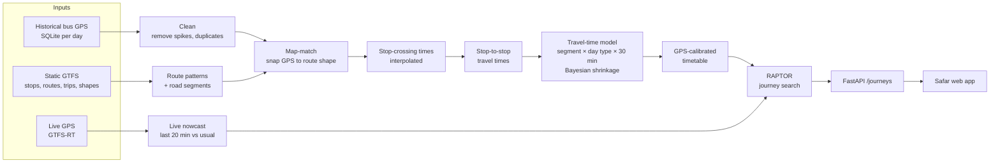
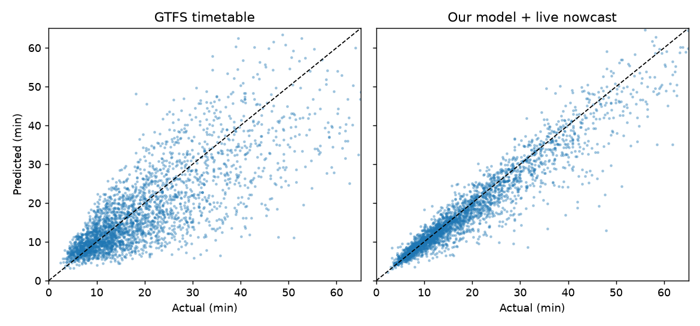
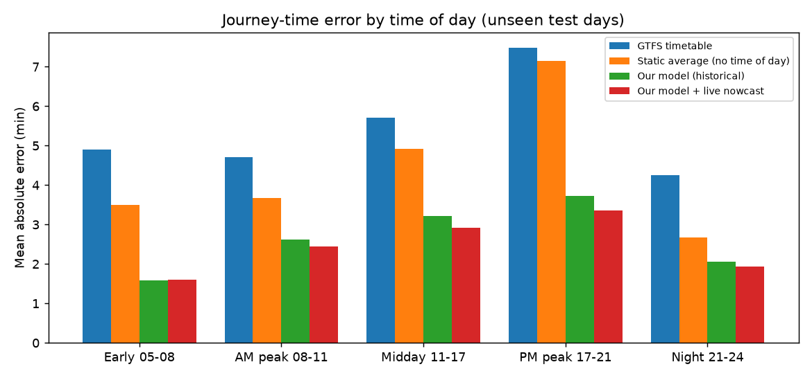

# 🚌 Safar: Real-time Bus Traffic Model and Journey Planner for Delhi

*Transport Stack Hackathon 2026 · Problem 1*

---

## 1. Problem statement

Delhi has thousands of buses on the road, and each one reports its GPS position every few seconds. The published timetable, however, assumes **fixed travel times**, so a commuter cannot tell whether a trip will take 30 minutes or 60.

**The challenge:** use the bus fleet as a set of moving sensors.

1. Build a **model of bus travel times** from real-time and historical GPS.
2. Build a **journey planner** on top of it. Given an origin, a destination and a departure time, it returns bus journey options (walk, board, route, transfers, alight, walk) with realistic total times.
3. Make the answers **change with time**. A 9 AM weekday trip must not get the same estimate as the same trip at 11 PM.
4. Expose it as an **API** with a simple screen to view the results.

---

## 2. Our solution: Safar

Safar learns how long every stretch of road between two bus stops **actually takes**, for every 30 minutes of the day and every day type, from how buses really move. It then plans journeys with those learned times instead of the printed timetable.

| Capability | What Safar does |
|---|---|
| **Travel-time model** | Stop-to-stop times learned from GPS, pooled across every route that uses the same road, by day type (weekday / Saturday / Sunday or holiday) × 30-minute bin |
| **Time-aware prediction** | Each road segment is predicted for the moment the bus actually reaches it (time propagation) |
| **Uncertainty** | Every journey comes with a likely range (80% band), not just a single number |
| **Live adjustment** | If buses are running slower than usual right now, near-term estimates adjust, and the effect fades smoothly back to the historical pattern |
| **Journey planning** | RAPTOR routing (the round-based algorithm used by modern transit planners) with up to 2 transfers, run on a GPS-calibrated timetable |
| **Traffic insight** | The journey now vs at the quietest hour vs the printed timetable, a "best time to leave" curve, and a city-wide traffic map built from the buses |
| **API + web app** | A documented FastAPI service and the **Safar** web app |

---

## 3. Workflow



**Step by step**

1. **Clean.** Drop out-of-area points, duplicate reports and GPS spikes (impossible jumps), and down-sample each bus's trace.
2. **Map-match.**
   - Project every GPS point onto the road shape of its route.
   - Keep only points close to the road that are moving forward.
   - Split each bus's day into individual trips, one per direction.
3. **Stop-crossing times.** Interpolate the exact time each bus passed each stop. Consecutive stops give **stop-to-stop travel times**, which already include dwell time at stops and waits at signals, exactly as a passenger experiences them.
4. **Travel-time model.**
   - For every road segment × day type × 30-minute bin, estimate the typical time and its spread.
   - Segments with little data borrow strength from the segment's all-day level plus the **city-wide congestion profile** (empirical-Bayes shrinkage), so there are no wild estimates.
5. **Time propagation.** A journey is predicted segment by segment, each at the time the bus will reach it.
6. **Live nowcast.** Recent GPS is matched the same way and compared with the usual times. The ratio adjusts the next few segments and fades over 30 minutes.
7. **Journey search.**
   - Scheduled departures are combined with GPS-predicted running times.
   - RAPTOR finds the fastest journeys with 0, 1 or 2 transfers, including walking to, from and between stops.
8. **Serve.** The REST API and the web app.

Full method: [docs/TECHNICAL_NOTE.md](docs/TECHNICAL_NOTE.md).

---

## 4. Project structure

```
safar-delhi-bus/
├── config.py                 paths and tunable parameters
├── transit/                  core engine
│   ├── geo.py                projection, polyline matching, spatial grid
│   ├── gtfs.py               GTFS → route patterns, geometry, segments, schedules
│   ├── gps.py                GPS reader (auto-detects columns) and cleaning
│   ├── matcher.py            GPS → trips → stop crossings → travel times
│   ├── model.py              travel-time model (shrinkage, propagation, uncertainty)
│   ├── router.py             GPS-calibrated timetables + RAPTOR
│   ├── live.py               live nowcast (GTFS-RT / replay)
│   └── planner.py            journey options, profile, traffic map
├── api/app.py                FastAPI service
├── web/index.html            Safar web app (Leaflet + Chart.js)
├── scripts/
│   ├── prepare_network.py    build the network from GTFS
│   ├── match_gps.py          map-match GPS (parallel, per day)
│   ├── build_model.py        train the travel-time model
│   ├── backtest.py           accuracy evaluation → docs/VALIDATION.md
│   ├── compare_google.py     comparison with Google Maps
│   └── make_synthetic.py     synthetic demo data
├── tools/r7z.py              extract selected days from the remote GPS archive
├── docs/
│   ├── TECHNICAL_NOTE.md     detailed method
│   ├── VALIDATION.md         accuracy report
│   └── img/                  result charts
├── sample_output.json        real API response
├── requirements.txt · Dockerfile · run_pipeline.bat · run_demo.bat
```

---

## 5. Model outputs

### City congestion profile learned from the buses

How much longer bus trips take at each time of day, compared with the fastest time. There is a clear morning peak, a sustained midday plateau and an evening peak around 18:00–19:00. Weekends are lighter.


### Predicted vs actual journey times

The printed timetable compared with Safar, against real observed bus journeys. Points on the dashed line are perfect predictions.



### Example journey: ISBT Kashmere Gate → Nehru Place, Tuesday 08:30

| | |
|---|---|
| Route | **425CLUP** (direct) |
| Board / alight | Kashmere Gate City Bus Terminal 08:43 → Nehru Place 09:28 (27 stops) |
| Door-to-door | **61 min**, likely range 50–72 min |
| Breakdown | walk 7 min · wait 9 min · ride 45 min |
| Same trip at the quietest hour | 49 min, so traffic adds **12 min** |
| Printed timetable estimate | 64 min |

The API also returns the route geometry, alternative options with transfers, and a "best time to leave" curve across the day. Full response: [`sample_output.json`](sample_output.json).

---

## 6. Results

Accuracy was measured on **held-out days the model never saw**. Each test is a real bus journey along a route; the predicted travel time is compared with the time the bus actually took ([full report](docs/VALIDATION.md)).

| Method | Mean abs. error | MAPE | within ±10% | within ±5 min |
|---|---|---|---|---|
| Printed GTFS timetable | 5.65 min | 29.0% | 20.8% | 60.9% |
| Average speed (no time of day) | 4.73 min | 21.9% | 29.7% | 69.6% |
| **Safar model** | **2.84 min** | **14.1%** | **48.2%** | **84.4%** |
| **Safar model + live nowcast** | **2.61 min** | **12.9%** | **50.4%** | **86.4%** |

**Key results**
- **54% lower error** than the printed timetable.
- **Evening peak (17:00–21:00):** error falls from **7.5 min to 3.4 min**.
- **86% of journeys** are predicted within ±5 minutes.
- The live nowcast improves accuracy further, using only information available before each journey starts.



---

## 7. API

| Endpoint | Returns |
|---|---|
| `GET /journeys?from=Kashmere Gate ISBT&to=Nehru Place&depart=2026-10-27T08:30` | Journey options (`from`/`to`: stop name or `lat,lng`) |
| `GET /profile?from=…&to=…&depart=…` | Door-to-door time for each departure, 05:00–23:00 |
| `GET /stops/search?q=nehru` | Stop name search |
| `GET /congestion?day_type=weekday&time=09:00` | Learned bus speed on every road segment |
| `GET /city-profile` | City congestion index through the day |
| `GET /live/status` · `GET /meta` | Live status · model and accuracy summary |

Interactive documentation is at `/docs` when the server is running.

---

## 8. How to run

```bash
pip install -r requirements.txt
```

**1. Data**
- **GPS archive:** use `tools/r7z.py` to extract only the days you need from the remote archive.
- **Static GTFS:** use the Transport Stack's `delhi_buses_static_gtfs_v1.zip`.

```bash
pip install py7zr
python tools/r7z.py list
python tools/r7z.py extract ../data/gps bus_movements_2026_10_27.db
```

```bat
set GPS_DIR=..\data\gps
set GTFS_DIR=..\data\gtfs
```

**2. Build**

```bash
python scripts/prepare_network.py
python scripts/match_gps.py --days all --workers 4
python scripts/backtest.py --train <days> --test <days>
python scripts/build_model.py --train all
```

**3. Run**

```bash
python -m uvicorn api.app:app --port 8000
```

- Web app: http://localhost:8000
- API docs: http://localhost:8000/docs

**Options**
- **Live mode:** set `LIVE_MODE=gtfsrt` with `GTFSRT_URL` and `GTFSRT_API_KEY`.
- **Replay mode:** set `LIVE_MODE=replay` with `LIVE_REPLAY_DB` and `LIVE_REPLAY_START` to replay any day as if it were live.
- **Quick demo:** `run_demo.bat` runs the whole pipeline on a small synthetic network.

---

## 9. Tech stack

- **Processing and modelling:** Python, NumPy, pandas
- **API:** FastAPI, Uvicorn
- **Frontend:** Leaflet, Chart.js
- **Data formats:** GTFS / GTFS-RT
- **Routing:** RAPTOR
- **Deployment:** Docker

## 10. Data sources

- **Delhi Transport Stack:** DTC bus GPS traces, static GTFS, and GTFS-RT.
- **Map tiles:** © Esri, © OpenStreetMap contributors.
