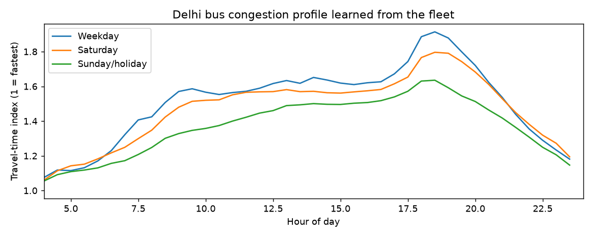
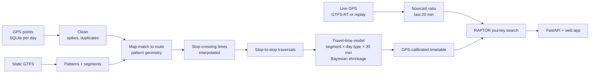

# 🚌 Safar: Delhi bus journey planner with travel times learned from bus GPS

*Transport Stack Hackathon 2026 · Problem 1: Real-time bus traffic model and journey planner*

The published timetable assumes fixed running times. Safar instead learns how long each stretch of road between two bus stops actually takes, at each time of day, from DTC bus GPS traces. It then plans bus journeys with those learned times.

## Results on real Delhi data

**Data used**
- 9 days of October 2026 DTC GPS data (Oct 6, 7, 8, 10, 11, 21, 22, 27, 28): about 263 million GPS points from up to 6,328 buses per day.
- Map-matching turned these into **11.6 million stop-to-stop travel-time observations**, covering **13,084 of the 15,119 road segments (86.5%)** in the GTFS network.

**Backtest**
- **Training:** 7 days (Oct 6, 7, 8, 10, 11, 21, 22).
- **Testing:** Oct 27–28. The model never saw these days.
- **Test journeys:** 40,000 randomly sampled stretches of 5–30 consecutive stops on buses actually observed on the test days. The "actual" time is the GPS-observed time.

Full report: [docs/VALIDATION.md](docs/VALIDATION.md).

| Method | Mean abs. error | MAPE | within ±10% | within ±5 min |
|---|---|---|---|---|
| GTFS timetable | 5.65 min | 29.0% | 20.8% | 60.9% |
| Static average (no time of day) | 4.73 min | 21.9% | 29.7% | 69.6% |
| Safar model (historical only) | 2.84 min | 14.1% | 48.2% | 84.4% |
| Safar model + live nowcast* | 2.61 min | 12.9% | 50.4% | 86.4% |

\* The live nowcast was evaluated by replaying the test days. For each journey, it used only GPS from buses that finished a segment in the 20 minutes *before* the journey started, so it had no information from the future.

**Overall:** the mean absolute error is 54% lower than the GTFS timetable (2.61 vs 5.65 min).

**By time of day:** the largest gain is in the 17:00–21:00 band, where error falls from 7.49 min (timetable) to 3.72 min (model) and 3.35 min (model + live nowcast).


## What it does

- **`GET /journeys`** takes an origin and a destination (a stop name or `lat,lng`) and a departure time. It returns up to 3 bus journeys, each with:
  - the walk to the first stop, where to board, the route, any transfers, where to get off, the final walk, and the total time
  - an **80% range**, from the spread of segment travel times
  - the **timetable's estimate** for the same trip
  - the **same trip at the quietest time of day**, to show the effect of traffic
  - how often buses on the route were observed at that hour, where enough observations exist
- **Routing:** RAPTOR (round-based public-transit routing) with up to 2 transfers, or 3 if no journey is found. It runs on the scheduled departures, with running times re-predicted by the model.
- **`GET /profile`:** door-to-door time for each departure from 05:00 to 23:00 along the best route ("best time to leave").
- **`GET /congestion`:** learned bus speed on every observed segment for a day type and time.
- **Web app** (`web/index.html`):
  - a map with journey options
  - a time-of-day traffic map
  - model and accuracy statistics
- **Speed:** a journey query on the full Delhi network takes a few seconds on a laptop.



*Travel-time index by time of day: each 30-minute bin's median deviation from the segment's all-day level, relative to the fastest bin. Learned from all matched segments.*

## How it works

Full detail is in [docs/TECHNICAL_NOTE.md](docs/TECHNICAL_NOTE.md).



1. **Map-matching.**
   - Each GPS point is projected onto the shape of its route (from `route_id` and the GTFS patterns).
   - Points more than 70 m from the shape are dropped, and so are points not moving forward.
   - The time the bus passes each stop is interpolated.
2. **Segment model.**
   - Stop A → B times are pooled across all routes that use that segment.
   - For each segment, day type (weekday / Saturday / Sunday or holiday) and 30-minute bin, the observed median is shrunk towards the segment's all-day level plus the city-wide congestion profile.
   - Segments that were never observed fall back to their length and their scheduled time.
3. **Time propagation.** Each segment is looked up at the time the bus is predicted to reach it, not at the departure time.
4. **Live nowcast.**
   - Recent GPS is matched the same way and compared with the model's expectation.
   - The ratio is applied to the next few segments and fades out over 30 minutes.
5. **Routing.** RAPTOR runs on the GTFS departures, with every downstream stop time re-predicted by the model.

## Quick start

Requires Python 3.10+ (developed on 3.14).

```bash
pip install -r requirements.txt
pip install py7zr            # only needed for tools/r7z.py
```

**1. Data**
- **GPS.** The archive is 16 GB: 31 daily SQLite files, each 3–5 GB uncompressed. `tools/r7z.py` reads the remote `.7z` with HTTP range requests and extracts only the days you name.
  ```bash
  python tools/r7z.py list
  python tools/r7z.py extract ../data/gps bus_movements_2026_10_27.db bus_movements_2026_10_28.db
  ```
- **Static GTFS.** Use the Transport Stack's `delhi_buses_static_gtfs_v1.zip`. We used the copy mirrored on the Mobility Database (feed `mdb-3666`, downloaded 2026-11-24). Unzip it to `../data/gtfs`.

```bat
set GPS_DIR=..\data\gps
set GTFS_DIR=..\data\gtfs
```

**2. Build.** These are the exact commands used for the results above.

```bash
python scripts/prepare_network.py
python scripts/match_gps.py --days 2026-10-06,2026-10-07,2026-10-08,2026-10-10,2026-10-11,2026-10-21,2026-10-22,2026-10-27,2026-10-28 --workers 4
python scripts/backtest.py --train "2026-10-06:2026-10-11,2026-10-21,2026-10-22" --test 2026-10-27:2026-10-28 --samples 40000
python scripts/build_model.py --train all
```

Each day is matched independently, so days run in parallel across workers.

**3. Run**

```bash
python -m uvicorn api.app:app --port 8000
```

- Web app: http://localhost:8000
- API docs: http://localhost:8000/docs

**Replay mode** feeds a historical day through the live code path:

```bat
set LIVE_MODE=replay
set LIVE_REPLAY_DB=..\data\gps\bus_movements_2026_10_28.db
set LIVE_REPLAY_START=2026-10-28T08:15
python -m uvicorn api.app:app --port 8000
```

**Live GTFS-RT:** set `LIVE_MODE=gtfsrt`, `GTFSRT_URL` and `GTFSRT_API_KEY`.

**Quick smoke test:** `run_demo.bat` generates a small synthetic network and runs the whole pipeline end to end.

## API

| Endpoint | Returns |
|---|---|
| `GET /journeys?from=Kashmere Gate ISBT&to=Nehru Place&depart=2026-10-27T08:30` | Journey options (`from`/`to`: stop name or `lat,lng`) |
| `GET /profile?from=…&to=…&depart=…` | Door-to-door minutes for each departure, 05:00–23:00 |
| `GET /stops/search?q=nehru` | Stop name lookup |
| `GET /congestion?day_type=weekday&time=09:00` | Learned speed on every observed segment |
| `GET /city-profile` | City congestion index by time of day |
| `GET /live/status` · `GET /meta` | Live mode status · data, model and validation summary |

Real response for the query above, trimmed (full response in [`sample_output.json`](sample_output.json)):

```json
{
  "query": {"from": {"name": "ISBT Kashmere Gate"}, "to": {"name": "Nehru Place"},
            "depart": "2026-10-27 08:30", "day_type": "weekday"},
  "options": [{
    "summary": "425CLUP", "depart": "08:30", "arrive": "09:31",
    "total_min": 61.4, "range_min": [50.5, 72.3],
    "walk_min": 7.1, "wait_min": 9.0, "ride_min": 45.3, "transfers": 0,
    "usual_at_quiet_hour_min": 49.4, "traffic_delay_min": 12.0, "timetable_estimate_min": 64.4,
    "legs": [
      {"type": "walk", "min": 4.0, "to": "Kashmere Gate City Bus Terminal"},
      {"type": "bus", "route": "425CLUP", "board_stop": "Kashmere Gate City Bus Terminal", "depart": "08:43",
       "alight_stop": "Nehru Place", "arrive": "09:28", "n_stops": 27, "ride_min": 45.3,
       "timetable_ride_min": 48.3, "observed_headway_min": null, "path": "[…]"},
      {"type": "walk", "min": 3.1, "to": "destination"}
    ]
  }]
}
```

## Repository layout

```
config.py              paths and tunable parameters
transit/
  geo.py               projection, polyline matching, spatial grid
  gtfs.py              GTFS -> patterns, geometry, segments, schedules
  gps.py               SQLite reader (auto-detects columns), cleaning
  matcher.py           GPS -> runs -> stop crossings -> traversals
  model.py             travel-time model (shrinkage, propagation, uncertainty, headways)
  router.py            GPS-calibrated timetables + RAPTOR
  live.py              live nowcast (GTFS-RT / replay)
  planner.py           journey options, profile, congestion map
api/app.py             FastAPI service
web/index.html         web app (Leaflet + Chart.js)
scripts/               prepare_network, match_gps, build_model, backtest, compare_google, make_synthetic
tools/                 r7z.py (partial archive extraction), inspection helpers
docs/                  TECHNICAL_NOTE.md, VALIDATION.md, img/
```

## Data sources

- **GPS:** Delhi Transport Stack, DTC GPS traces for October 2026, from the problem statement's archive (`vehicle_feed` table: vehicle_id, lat, lng, speed, route_id, trip_id, timestamp).
- **Static GTFS:** Delhi Transport Stack `delhi_buses_static_gtfs_v1.zip`, via the Mobility Database mirror (mdb-3666). It has 6,862 stops, 2,574 routes and 80,357 trips.
- **Map tiles:** © Esri, © OpenStreetMap contributors.
