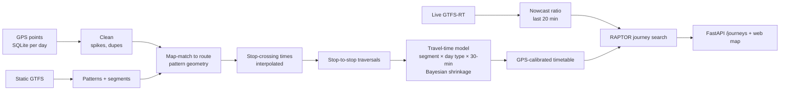

# 🚌 Safar: Delhi bus journeys with travel times learned from the bus fleet

*Built for the Transport Stack Hackathon 2026 · Problem 1: Real-time bus traffic model and journey planner*

Delhi's timetable gives a trip the same running time at 9 am and at 11 pm. This project turns the GPS signal from thousands of DTC buses into **travel times a commuter can rely on**, and builds a journey planner on top of them.

> **Existing apps show where your bus is. This one predicts how long your whole trip will take at the time you leave, learned from how buses actually move.**

| | Timetable | Live-tracking apps | **This project** |
|---|---|---|---|
| Running time changes with hour and day type | ✗ | partly | ✅ 30-min bins × weekday / Sat / Sun |
| Learned from real bus GPS | ✗ | partly (ETA to stop) | ✅ every stop-to-stop segment, pooled across routes |
| Time-propagated (each segment at the time you reach it) | ✗ | ✗ | ✅ |
| Uncertainty range | ✗ | ✗ | ✅ 80% range per journey |
| Live nowcast blended with history | ✗ | live only | ✅ fades from live to historical over 30 min |
| Peak vs quiet-hour comparison, "best time to leave" | ✗ | ✗ | ✅ |
| Measured accuracy on unseen days | ✗ | not published | ✅ [VALIDATION.md](docs/VALIDATION.md) |
| Open, documented API | GTFS only | closed | ✅ FastAPI + OpenAPI docs |

## Results on real Delhi data

**Data used:** 9 days of October 2026 DTC GPS data, about 260 million points from around 6,300 buses. Map-matching turned this into **11.6 million stop-to-stop travel-time observations**, covering **86.5% of the 15,119 road segments**.

**Backtest:** the model was trained on Oct 6–22 and tested on Oct 27–28, which it never saw. It was scored on 40,000 real bus journeys of 5–30 stops ([full report](docs/VALIDATION.md)).

| Method | Mean abs. error | MAPE | within ±5 min |
|---|---|---|---|
| Published GTFS timetable | 5.65 min | 29.0% | 60.9% |
| Static average (no time of day) | 4.73 min | 21.9% | 69.6% |
| **Safar model** | **2.84 min** | **14.1%** | **84.4%** |
| **Safar model + live nowcast** | **2.61 min** | **12.9%** | **86.4%** |

**Overall:** 54% less error than the timetable.

**In the evening peak (17:00–21:00):** the error falls from 7.5 to 3.4 minutes.


## Features

- **`GET /journeys`** returns 1–5 bus journey options. Each option gives:
  - the walk to the first stop, where to board, the route, transfers, where to get off, the final walk, and the total time
  - an **80% range**
  - the **timetable estimate**
  - the **usual time at the quietest hour**
  - how often buses actually came on that route at that hour
- **RAPTOR routing** (the algorithm used by production journey planners) with up to 2 transfers. It runs on a timetable whose running times are **re-predicted from GPS**.
- **Live nowcast** from the GTFS-RT feed, plus a `replay` mode that re-plays any October day as if it were live.
- **"Best time to leave"** profile of door-to-door time across the day.
- **City traffic map**: speeds on every road segment, measured by the buses, with a time slider.
- **Backtest**: train on Oct 1–24, test on Oct 25–31 against real trips. Compared with the timetable, a static-average baseline and Google Maps.


## How it works (short version, full detail in [docs/TECHNICAL_NOTE.md](docs/TECHNICAL_NOTE.md))



1. **Map-matching.** GPS points are projected onto the route's road shape. Only points within 70 m that keep moving forward count. The time the bus passes each stop is then interpolated.
2. **Segment model.** Stop A → B travel times are pooled over all routes that use that segment. For each segment, day type and 30-minute bin, the median is shrunk towards *segment level + city congestion profile*. This gives a robust fallback where there is little data.
3. **Time propagation.** Each segment is looked up at the time the bus is predicted to reach it.
4. **Live data.** If buses on a corridor are slower than usual *right now*, near-term segments are slowed by the same ratio. The effect fades over 30 minutes.
5. **Routing.** RAPTOR runs on scheduled departures with re-predicted running times.

## Quick start

Requires Python 3.10+.

```bash
pip install -r requirements.txt
```

**1. Get the data.**

The GPS archive is 16 GB (31 daily SQLite files of 3–5 GB each). You don't need all of it: `tools/r7z.py` reads the remote `.7z` with HTTP range requests and extracts only the days you name.

```bash
pip install py7zr
python tools/r7z.py list                                   # files and sizes inside the archive
python tools/r7z.py extract ../data/gps bus_movements_2026_10_07.db bus_movements_2026_10_27.db
```

The static GTFS is the Transport Stack's `delhi_buses_static_gtfs_v1.zip`. It is also mirrored on the Mobility Database (feed `mdb-3666`). Unzip it to `../data/gtfs`.

```bat
set GPS_DIR=..\data\gps
set GTFS_DIR=..\data\gtfs
```

**2. Build** (or just run `run_pipeline.bat`):

```bash
python scripts/prepare_network.py                       # GTFS -> network.pkl
python scripts/match_gps.py --days all --workers 4      # GPS -> stop-to-stop traversals (per day, resumable)
python scripts/backtest.py --train 2026-10-01:2026-10-24 --test 2026-10-25:2026-10-31   # -> docs/VALIDATION.md
python scripts/build_model.py --train all               # final model on all days
```

**3. Run:**

```bash
python -m uvicorn api.app:app --port 8000
```

- Web app: http://localhost:8000
- API docs: http://localhost:8000/docs

**Live demo with replay:** re-plays 28 Oct as if it were live.

```bat
set LIVE_MODE=replay
set LIVE_REPLAY_DB=C:\...\bus_movements_2026_10_28.db
set LIVE_REPLAY_START=2026-10-28T08:15
python -m uvicorn api.app:app --port 8000
```

**Real live feed:** set `LIVE_MODE=gtfsrt`, `GTFSRT_URL` and `GTFSRT_API_KEY` (the key comes from delhi.transportstack.in).

**No data yet?** `run_demo.bat` generates a small synthetic city and runs the whole pipeline end to end.

## API

| Endpoint | What it returns |
|---|---|
| `GET /journeys?from=Kashmere Gate ISBT&to=Nehru Place&depart=2026-10-27T08:30` | Journey options. `from`/`to` accept `lat,lng` or a stop name |
| `GET /profile?from=…&to=…&depart=…` | Door-to-door minutes for each departure, 05:00–23:00 |
| `GET /stops/search?q=nehru` | Stop name lookup |
| `GET /congestion?day_type=weekday&time=09:00` | Speed on every observed segment |
| `GET /city-profile` | City congestion index by time of day |
| `GET /live/status` · `GET /meta` | Live feed status · model coverage and validation summary |

Example response from the real data, trimmed (full response in [`sample_output.json`](sample_output.json)):

```json
{
  "query": {
    "from": {
      "name": "ISBT Kashmere Gate"
    },
    "to": {
      "name": "Nehru Place"
    },
    "depart": "2026-10-27 08:30",
    "day_type": "weekday"
  },
  "options": [
    {
      "summary": "425CLUP",
      "depart": "08:30",
      "arrive": "09:31",
      "total_min": 61.4,
      "range_min": [
        50.5,
        72.3
      ],
      "walk_min": 7.1,
      "wait_min": 9.0,
      "ride_min": 45.3,
      "transfers": 0,
      "usual_at_quiet_hour_min": 49.4,
      "traffic_delay_min": 12.0,
      "timetable_estimate_min": 64.4,
      "legs": [
        {
          "type": "walk",
          "min": 4.0,
          "to": "Kashmere Gate City Bus Terminal"
        },
        {
          "type": "bus",
          "route": "425CLUP",
          "board_stop": "Kashmere Gate City Bus Terminal",
          "depart": "08:43",
          "alight_stop": "Nehru Place",
          "arrive": "09:28",
          "n_stops": 27,
          "ride_min": 45.3,
          "timetable_ride_min": 48.3,
          "observed_headway_min": null,
          "path": "[…]"
        },
        {
          "type": "walk",
          "min": 3.1,
          "to": "destination"
        }
      ]
    }
  ]
}
```

## Validation

- **Results:** see **[docs/VALIDATION.md](docs/VALIDATION.md)** (generated by `scripts/backtest.py`). It reports MAE, MAPE, the share of journeys within ±10%, and a breakdown by time of day, for the timetable, a static average, our model, and our model with live nowcast.
- **Google Maps comparison:** fill `validation_pairs.csv`, run `python scripts/compare_google.py`, and the table is written to **[docs/GOOGLE_COMPARISON.md](docs/GOOGLE_COMPARISON.md)**.

## Repository layout

```
config.py              paths and all tunable parameters
transit/
  geo.py               projection, polyline matching, spatial grid
  gtfs.py              GTFS -> patterns, geometry, segments, schedules
  gps.py               SQLite reader (auto-detects columns), cleaning
  matcher.py           GPS -> runs -> stop crossings -> traversals
  model.py             travel-time model (shrinkage, propagation, uncertainty, headways)
  router.py            GPS-calibrated timetables + RAPTOR
  live.py              live nowcast (GTFS-RT / replay)
  planner.py           journey options, profile, congestion map
api/app.py             FastAPI service
web/index.html         map UI (Leaflet + Chart.js)
scripts/               prepare_network, match_gps, build_model, backtest, compare_google, make_synthetic
docs/                  TECHNICAL_NOTE.md, VALIDATION.md, GOOGLE_COMPARISON.md
```

## Limitations and next steps

- **Data gaps.** Some daily GPS files end early (Oct 7 stops at about 19:50 IST), so late evenings have fewer observations. Sparse cells lean on the shrinkage prior.

- **Little training data.** The model is trained on one month, and Sundays/holidays have fewer days of data.
- **Waiting time at the first stop.** It comes from scheduled departures. The wait observed from GPS headways is shown alongside.
- **Next steps:**
  - metro legs (multimodal RAPTOR)
  - crowding (Problem 2)
  - weather and event corrections
  - arrival prediction for the next specific bus

## Data

- **Delhi Transport Stack** (delhi.transportstack.in): DTC GPS traces for October 2026 (`vehicle_feed` table, about 25 million points and 6,000 buses per day), the static GTFS feed (6,862 stops, 2,574 routes, 80,357 trips), and the GTFS-RT feed.
- **Map tiles:** © Esri, © OpenStreetMap contributors.
