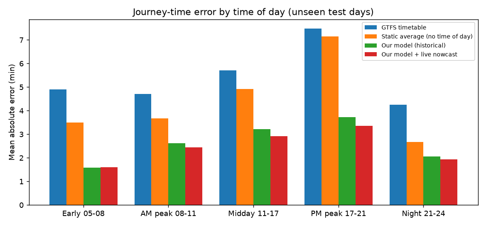
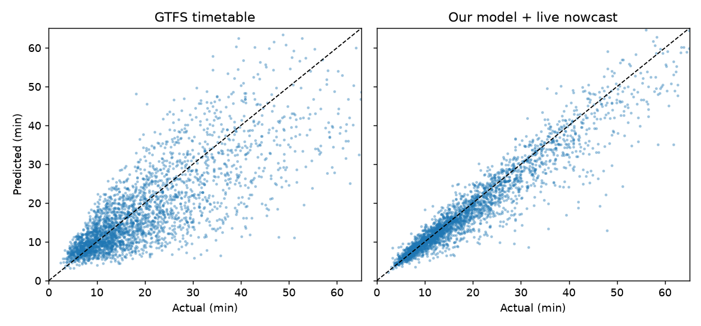
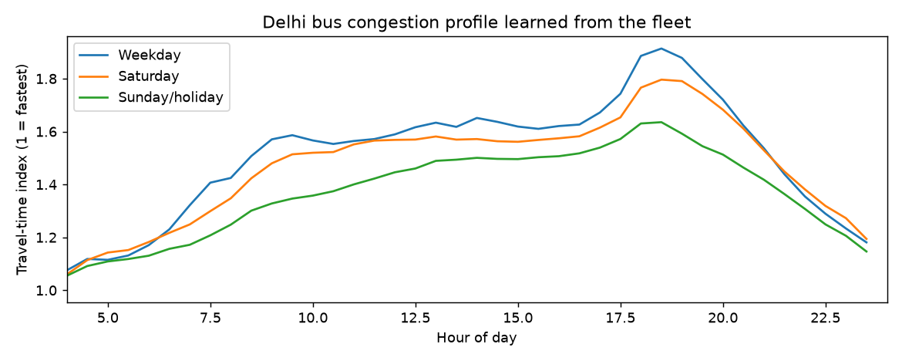

# Validation report

*Train days:* 2026-10-06 → 2026-10-22 (7 days)  
*Test days (unseen):* 2026-10-27 → 2026-10-28 (2 days)  
*Journeys evaluated:* 40,000 real bus journeys of 5–30 stops, sampled from GPS-observed trips  
*Road segments with GPS data:* 86.0%

## Overall

| Method | MAE (min) | MAPE | within ±10% | within ±5 min | bias (min) |
|---|---|---|---|---|---|
| GTFS timetable | 5.65 | 29.0% | 20.8% | 60.9% | -1.92 |
| Static average (no time of day) | 4.73 | 21.9% | 29.7% | 69.6% | -3.2 |
| Our model (historical) | 2.84 | 14.1% | 48.2% | 84.4% | -1.23 |
| Our model + live nowcast | 2.61 | 12.9% | 50.4% | 86.4% | -1.31 |

**Error reduced by 54% versus the published timetable.**

## By time of day (MAE, minutes)

| Band | GTFS timetable | Static average (no time of day) | Our model (historical) | Our model + live nowcast |
|---|---|---|---|---|
| Early 05-08 | 4.91 | 3.5 | 1.59 | 1.6 |
| AM peak 08-11 | 4.71 | 3.67 | 2.62 | 2.44 |
| Midday 11-17 | 5.71 | 4.92 | 3.21 | 2.91 |
| PM peak 17-21 | 7.49 | 7.15 | 3.72 | 3.35 |
| Night 21-24 | 4.26 | 2.67 | 2.05 | 1.94 |

## Method

* Test journeys are real: a random stretch of 5–30 consecutive stops on a bus that was actually observed on a test day; *actual* = observed GPS time.
* The model never sees test days. The live variant only uses buses that finished a segment in the 20 minutes **before** the journey starts (no look-ahead).
* Timetable baseline = the scheduled trip of the same pattern closest in time.

### Error by time of day

### Predicted vs actual

### City congestion profile

## Google Maps comparison

Not done yet. Fill in `validation_pairs.csv` with Google Maps times, then run `scripts/compare_google.py`.